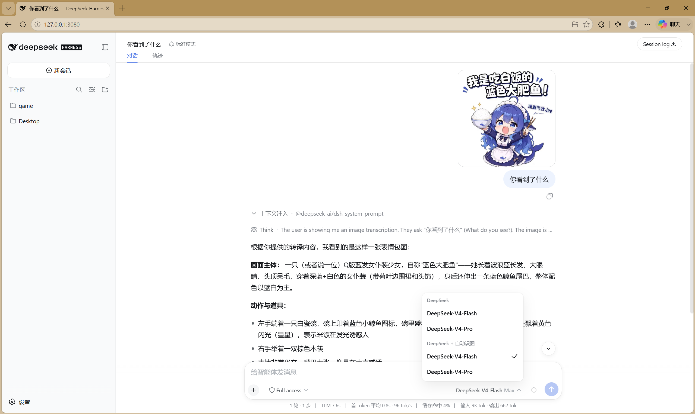
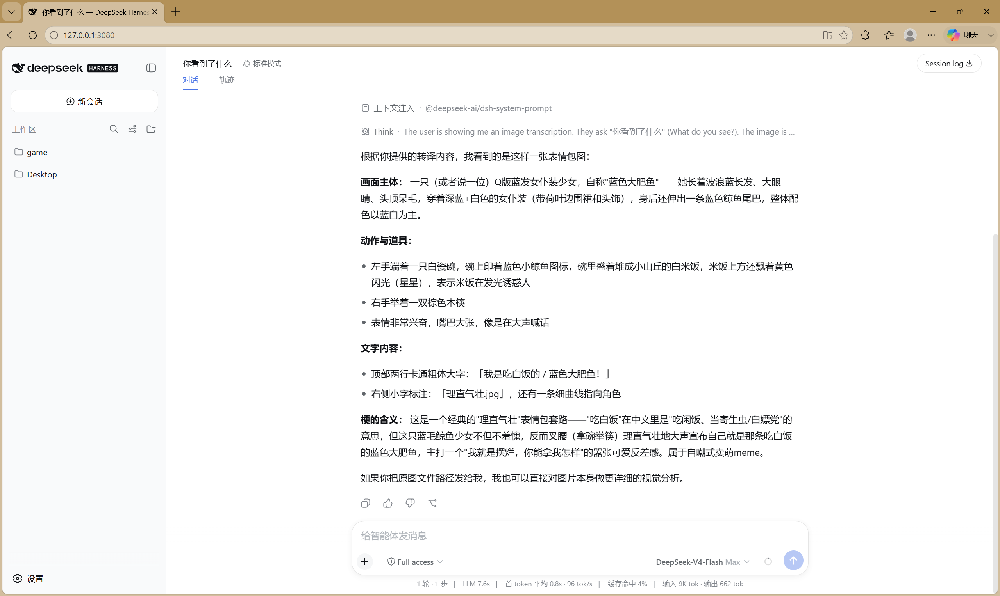

# dsh-vision-proxy

[English](README.en-US.md) | [简体中文](README.md)

**Keep DeepSeek as the conversation brain — attach images anyway.** GUI image attachments are auto-transcribed for text-only DeepSeek models on [DeepSeek Harness](https://github.com/deepseek-ai/deepseek-harness), with a settings page in the dsh Web/Desktop UI.

<p align="center">
  <a href="https://awesome-dsh-plugin.com"></a>
  <a href="https://www.npmjs.com/package/dsh-vision-proxy"></a>
  <a href="https://github.com/Flyvhidbwo/dsh-vision-proxy/actions/workflows/ci.yml"></a>
  
  
  =22.19" />
  <a href="https://github.com/Flyvhidbwo/dsh-vision-proxy"></a>
</p>

> ⚠️ **Compatibility & positioning (Oct 2026, v0.5.0)**: verified against **dsh 0.2.x** (desktop runtime 0.2.1-rc.3 and CLI 0.2.1-rc.5). The plugin also ships a **Settings → Vision proxy** page so everything is configurable in the UI, live, without restarting.
>
> Since dsh 0.2.x, DeepSeek's natively multimodal models (`deepseek-flash`, `deepseek-v4-flash-vision-exp`, …) accept images directly — **you do not need this plugin for those**. The plugin covers the other half: **text-only models still cannot see images** (e.g. `deepseek-v4-pro`). It transcribes images to text before handing the conversation to them. Typical uses: a text-only Pro/Flash brain with eyes, local Ollama (images never leave the machine, free), any OpenAI-compatible VLM. **When the selected model already accepts images, images are passed through untranslated.**
>
> v0.5.0 fixes the root cause of the "silent failure on dsh 0.2.x" reported in issue #2: on 0.2.x `ctx.llm.registration()` **throws** `NO_ADAPTER` while the wrapped route is not registered yet (it does not return `undefined`), and 0.4.1 called it synchronously inside `apply()`, so the entry never activated and the route never existed. The adapter is now resolved lazily, with inner-route discovery (`deepseek-official` or `deepseek-account`).

## Why this exists

DeepSeek Harness natively gates image attachments on the selected model's declared `inputModalities`. A text-only model rejects attachments by design, and tool-based vision plugins (`view_image` on a file path) do not help with **GUI image attachments**.

This plugin closes that gap: it registers a new provider route (`deepseek-vision`) that wraps the real DeepSeek adapter, claims image input (so the attachment preflight admits images), and **transcribes every attached image to text in the request stream** before delegating to DeepSeek. The conversation is still answered by DeepSeek; vision is an add-on.

```
user attaches image ──▶ deepseek-vision route ──▶ transcribe via VLM (OCR + layout + details)
                          │                        │
                          ▼                        ▼
                  DeepSeek answers ◀── text-only conversation (images replaced by [图片转译] text)
```

## Features

- **Settings page in the dsh UI.** Settings → **Vision proxy**: edit endpoint, model, timeouts, failure policy and more (15 fields). Saving writes the profile's `cordis.patch.yml` and applies to the **next turn, live**; secret fields only show "stored" and are never sent back to the browser.
- **Native-vision pass-through.** When the selected model declares image input (`deepseek-flash`, `deepseek-v4-flash-vision-exp`, …), images go straight through — no wasted VLM call and no loss of native quality.
- **Inner-route discovery.** If the configured `innerProvider` is not registered, the plugin falls back to `deepseek-official` → `deepseek-account` → any registered route. An API-key profile and a signed-in-account profile both work out of the box.
- **No hangs, ever.** *Public anonymous* endpoints are hard-capped at 20 s and HTTP 429 fails immediately (no useless `Retry-After` sleep); endpoints that just failed are cooled down for 60 s. **Loopback endpoints are exempt from that policy**: a cold Ollama load is legitimately slow, so the configured timeout applies and `keep_alive` keeps the model resident.
- **Multi-model, multi-provider.** Any OpenAI-compatible VLM endpoint works — DashScope/Qwen, QwenCloud (international), Zhipu, OpenRouter, local Ollama, or your own. Each `fallbackModels` entry can carry its **own** `baseURL`/`model`, so one install can chain providers.
- **Zero-config local path.** With `autoLocalOllama` (default on), a running Ollama at `http://localhost:11434` is detected at startup and appended to the fallback chain — images never leave your machine.
- **Thinking-model tolerance.** `qwen3-vl`, `deepseek-flash` and friends can spend the whole output budget on `reasoning` and return an empty `content`; the reasoning text is then used instead of discarding a completed transcription.
- **Transcription survives session aborts.** By default the session-level abort signal is *not* chained into the transcription request (`abortWithSession: false`): dsh cancels and re-issues work around large images, and the old behaviour killed inferences the GPU was already running. Opt back in from the settings page.
- **Fallback chain with classified errors.** `rate_limit` / `quota` / `auth` / `region` / `model_not_found` / `context_too_large` / `http` are classified with actionable hints; the placeholder reports **every** attempt, not just the first.
- **Content-hash cache.** Transcriptions are cached by the SHA-256 of the image bytes (in-process, capped at 200) — the same image is transcribed at most once per process.
- **Auto-downscale (optional).** On dsh 0.2.x the attachment service's `readImageRequest` projection does the resize natively (cached); older backends fall back to `readImage` plus optional `sharp` downscaling.
- **`read_image` compatible.** The native `read_image` tool also works on this route (its capability gate reads the same model info).

## Supported models & providers

One config (`baseURL` + `model`, optionally `apiKey`) covers every backend:

| Scenario | baseURL | model | Notes |
|---|---|---|---|
| **DeepSeek official vision** — default | `https://api.deepseek.com` | `deepseek-v4-flash-vision-exp` | Reuses `DEEPSEEK_API_KEY`, no extra key; best official vision quality |
| **DashScope (China)** | `https://dashscope.aliyuncs.com/compatible-mode/v1` | `qwen3.7-flash` / `qwen3-vl-flash` | Cheap, fast, no rate limit. Keys: `sk-ws-…` (Qwen platform) or `sk-…` (Bailian console) |
| **Local Ollama (auto-detected)** | `http://localhost:11434/v1` | first vision-capable model | Zero config when installed; images never leave the machine; `keep_alive` is sent |
| **QwenCloud (intl.)** | `https://dashscope-intl.aliyuncs.com/compatible-mode/v1` | `qwen3-vl-plus` etc. | International variant |
| **Zhipu (free tier)** | `https://open.bigmodel.cn/api/paas/v4` | `glm-4.6v-flash` | Free tier, still needs a (free) Zhipu API key |
| **Anything OpenAI-compatible** | your endpoint | your model | OpenRouter, Ark, vLLM, gateways — the plugin only speaks `/chat/completions` |

> ⚠️ **Anonymous third-party free tiers are NOT bundled as a default fallback.** In field testing they were strictly rate-limited and occasionally hung; as a default they just reproduce a broken experience. If you still want one, add it via `fallbackModels` with `anonymous: true` (the 20 s cap still applies).

### Pricing (CNY, Alibaba Model Studio mainland + DeepSeek official, Aug 2026 reference)

| Model | Input | Output | One 1080p screenshot (≈2000 tokens) |
|---|---|---|---|
| qwen3-vl-flash | ¥0.15 / M tokens | ¥1.5 / M tokens | ≈ ¥0.0005 |
| qwen3.7-flash | ¥0.2 / M tokens | ¥0.8 / M tokens | ≈ ¥0.001 |
| **deepseek-v4-flash-vision-exp** (official, default) | ¥3 / M (peak) · ¥1.5 (off-peak) | ¥9 / M (peak) · ¥4.5 (off-peak) | ≈ ¥0.01 / ¥0.005 |
| Local Ollama | free | free | ¥0 (images never leave the machine) |

> Images are billed by resolution-derived tokens, not per image. A 1080p screenshot is ≈ 2000 tokens, i.e. well under one fen per image; heavy use (100 images a day) costs a few yuan a month. Local Ollama is free.

**Key resolution order**: config `apiKey` → `$VISION_API_KEY` → `$DASHSCOPE_API_KEY`. Anonymous and loopback endpoints need none; keyless non-anonymous entries are skipped.

## Quick start

```sh
# profile name as used by your host: the desktop app uses `desktop`, `dsh web` uses `web`
dsh plugin --profile desktop add dsh-vision-proxy
```

After a restart:

1. the model picker shows **DeepSeek + auto vision** (select it so a text-only brain receives images);
2. **Settings → Vision proxy** edits the configuration (applies on the next turn, no restart; secrets are never echoed back);
3. paste an image into any conversation.

> Default strategy: transcribe with DeepSeek's official vision model (`deepseek-v4-flash-vision-exp`, reusing `DEEPSEEK_API_KEY`); otherwise use `VISION_API_KEY` / `DASHSCOPE_API_KEY` at DashScope; a local Ollama is appended automatically; **models that already accept images are passed through untranslated**.

**pnpm ≥ 10 blocks dependency build scripts** — the first install exits non-zero with `Ignored build scripts: dsh-vision-proxy, sharp`. Approve both, then re-run the install:

```yaml
# profile's pnpm-workspace.yaml
allowBuilds:
  dsh-vision-proxy: true
  sharp: true
```

```sh
dsh plugin --profile desktop add dsh-vision-proxy   # re-run after approval
```

> **Slow npm registry?** `dsh plugin --profile desktop add dsh-vision-proxy --registry=https://registry.npmmirror.com` (arguments are forwarded to pnpm).

### Alternative installs (while npm publishing is temporarily unavailable)

- **From GitHub**: `dsh plugin --profile desktop add github:Flyvhidbwo/dsh-vision-proxy`; in the desktop app use **Plugins → Add plugin → Git repository** with `github:Flyvhidbwo/dsh-vision-proxy` (installs the default branch with the latest fixes).
- **From a local tarball**: grab a `.tgz` from the repository releases (or build one locally) and use **Plugins → Add plugin → Tarball**.

## Live demo: a real GUI image turn

A real conversation on the `deepseek-vision` route: the user pasted a sticker and asked **"what do you see"**; the VLM transcribed it and DeepSeek answered from the text in a single step (~7.6 s).

<p align="center">
  
  
</p>

## Configuration

**Preferred: the settings page.** Settings → **Vision proxy** edits 15 live fields; saving writes the profile's `cordis.patch.yml` and applies to the next turn. Secret fields show only "stored".

**The four restart-only knobs** (`providerId`, `innerProvider`, `autoLocalOllama`, `fallbackModels`) live in the profile patch as an **id-targeted override**, never an `insert`:

```yaml
# $DSH_HOME/profiles/desktop/cordis.patch.yml — user-layer override
- id: dsh-vision-proxy
  name: 'dsh-vision-proxy'
  config:
    providerId: deepseek-vision
    innerProvider: deepseek-official
    autoLocalOllama: true
    fallbackModels: []
```

> ⚠️ **Do not write `- insert: [{id: dsh-vision-proxy, …}]`.** In dsh's patch semantics `insert` appends entries — the bundle's row and yours would both be instantiated and the `deepseek-vision` adapter would be registered twice. A top-level `- id:` entry targets the existing row and replaces its whole `config`; omitted keys fall back to the plugin's zod defaults. The settings page saves in exactly that form.

| Key | Default | Meaning |
|---|---|---|
| `providerId` | `deepseek-vision` | Route id shown in the model picker (**restart**) |
| `innerProvider` | `deepseek-official` | Wrapped route; falls back to `deepseek-account` → any registered route (**restart**) |
| `baseURL` | DashScope compatible mode | OpenAI-compatible VLM endpoint (any vendor, including Ollama) |
| `apiKey` | `''` | VLM key; falls back to `$VISION_API_KEY`, then `$DASHSCOPE_API_KEY`. Never echoed to the browser |
| `anonymous` | `false` | Skip the Authorization header (public registration-free endpoints; 20 s cap applies). Loopback is always treated as local |
| `model` | `qwen3.7-flash` | Vision model id (`qwen3-vl-flash`, `glm-4.6v-flash`, `qwen3-vl:8b`, …) |
| `maxTokens` | `8192` | VLM output cap (thinking models need room for reasoning) |
| `timeoutMs` | `120000` | Request timeout (public anonymous endpoints are capped at 20 s; loopback keeps this value) |
| `maxImagePixels` | `4000000` | Downscale images above this many pixels before transcription (0 disables) |
| `keepAlive` | `30m` | `keep_alive` sent to loopback servers (Ollama residency; empty disables the field) |
| `marker` | `[图片转译]` | Prefix on every transcription |
| `failureMode` | `placeholder` | On total failure: `placeholder` inserts `[图片转译失败: …]` and continues; `error` fails the turn |
| `abortWithSession` | `false` | Abort a running transcription when the conversation is cancelled (off keeps finished inferences) |
| `deepseekVision` | `true` | Prefer DeepSeek's official vision model for transcription |
| `deepseekVisionModel` | `deepseek-v4-flash-vision-exp` | Model used for that transcription |
| `nativeVisionPassThrough` | `true` | Models that already accept images are passed straight through |
| `autoLocalOllama` | `true` | Probe `http://localhost:11434` at startup (**restart**) |
| `localOllamaModel` | `''` | Pin an Ollama model; empty picks the first vision-capable one |
| `fallbackModels` | `[]` | Ordered fallbacks `{model, baseURL?, apiKey?, anonymous?, timeoutMs?}` (**restart**) |

> **Windows and API keys**: `dsh --profile <name> --dump-config` prints the composed config, including a key written into `cordis.patch.yml`. Conversely, environment variables set after the process started (explorer.exe caches its environment) may never reach a running dsh. If you exported a key but still see `skipped — no API key`, **put the key into Settings → Vision proxy** (or the plugin config).

## Verify the install

```sh
dsh --profile desktop --dump-config | grep -A3 dsh-vision-proxy   # exactly one row (prints the config, key included)
```

1. Restart dsh → the model picker shows **DeepSeek + auto vision**.
2. Settings shows the **Vision proxy** page (means the volatile settings namespace is served).
3. Paste an image → DeepSeek answers after a `[图片转译]` block.
4. If the selected model already accepts images (`deepseek-flash`), images pass through with **no** transcription request.

## Behavior notes

- Only messages containing image blocks are processed; text-only turns go straight to DeepSeek.
- Public anonymous endpoints: 20 s cap, immediate 429 failure, 60 s cooldown after a failure. Loopback endpoints are exempt.
- Transport failures (`fetch failed`, connection refused, …) also cool the endpoint down for 60 s.
- **A session can never be poisoned** (`failureMode: placeholder`): a failed image becomes `[图片转译失败: 原因]` text listing every attempt; the failure is remembered by content hash for 60 s.
- Thinking models: an empty `content` with `reasoning` / `reasoning_content` uses the reasoning text instead of discarding the inference.
- **34 unit tests** (including `scripts/verify-runtime-contract.mjs`, which mounts the proxy into a real `dsh-llm` runtime), run by GitHub Actions on Node 22/24.
- Transcription quality: dense UI screenshots may lose small text — that is the VLM's limit, not a plugin bug. Prefer a stronger model (`qwen3-vl-plus`) or a larger `maxTokens` for OCR-heavy work.

## Troubleshooting

| Symptom | Cause & fix |
|---|---|
| On dsh 0.2.x: `1 entry did not activate`, no route in the model picker (0.4.1) | 0.2.x `registration()` throws `NO_ADAPTER`; 0.4.1 called it inside `apply()`. **Upgrade to 0.5.0** |
| No "DeepSeek + auto vision" group in the picker | Check that the profile's `cordis.patch.yml` has exactly one `dsh-vision-proxy` row (`dsh --profile desktop --dump-config`). For a signed-in-account profile set `innerProvider: deepseek-account` or leave it to auto-discovery |
| No "Vision proxy" page in Settings | The page only registers while the host serves the `dsh-vision-proxy` settings namespace — confirm the row is enabled and the profile loads it |
| `skipped — no API key` even though `VISION_API_KEY` is exported | explorer.exe caches the environment. Put the key in Settings → Vision proxy (or the plugin config) |
| Local Ollama times out every image (20 s) | 0.4.x wrongly applied the anonymous cap to loopback. **Fixed in 0.5.0** (loopback is local, `keep_alive` is sent) |
| Local Ollama: `request (N tokens) exceeds the available context size (4096)` | Ollama's default context is too small. Set `OLLAMA_CONTEXT_LENGTH=32768` and restart Ollama |
| With `@anionex/dsh-vision-toolkit` installed: `needs no image-input variant` | Both plugins provide image input; the features overlap. Disable the toolkit's variant for this route (add `config: { imageInputVariants: { enabled: false } }` to its row in the profile patch) or uninstall one of them |
| Install warns `Ignored build scripts: dsh-vision-proxy, sharp` | pnpm ≥ 10 blocks build scripts; approve both in the profile's `pnpm-workspace.yaml` (`allowBuilds`) and re-run |
| `ERR_PNPM_MINIMUM_RELEASE_AGE_VIOLATION` right after a release | pnpm 11's `minimumReleaseAge` (1 day). Set `minimumReleaseAge: 0` in the profile's `pnpm-workspace.yaml` or pass `--config.minimum-release-age=0` |

## Privacy

Transcription sends image bytes (base64 over HTTPS) to the configured VLM endpoint — **image data leaves your machine** unless `baseURL` points at a local service (e.g. Ollama). Nothing is persisted beyond the harness's own attachment store. For sensitive images use your own endpoint or a local model — or do not install the plugin.

## How it works (for plugin developers)

The plugin uses only public dsh 0.2.x interfaces:

- `ctx.llm.registerAdapter([providerId], proxyAdapter)` registers the new route;
- the wrapped adapter is resolved **lazily**: `ctx.llm.registration(inner)` **throws** `NO_ADAPTER` (it does not return `undefined`), so resolving it inside `apply()` breaks with cordis activation order;
- the proxy's `listModels` / `resolveModel` query the **inner route** for metadata and re-stamp `provider` with the route the caller asked about — `dsh-llm` validates `model.provider === requested route` and otherwise rejects the whole catalog with `INVALID_CATALOG`;
- `resolveModel` overrides `inputModalities` with `['text', 'image']` so the attachment preflight and the `read_image` gate admit images;
- `prepareCall` binds the inner `prepareCall` generation and `stream` transcribes image blocks before `yield*`-ing the inner stream; image bytes come from `ctx.get('attachments').readImageRequest(ref, target, signal)` (0.2.x public projection API), with a `readImage(ref)` fallback;
- Config fields exposed to the settings page are declared `.volatile()` (`@deepseek-ai/schemastery`): dsh serves the volatile fields of the active, uniquely-locatable entry as a settings namespace, persists writes into the profile's `cordis.patch.yml`, and pushes them to the running plugin through references;
- the browser half `lib/client.js` is declared through `dsh.client`, served under `/plugins`, registers a `settings.section` navigation entry, and reads/writes the namespace through `ctx.configForms.get('dsh-vision-proxy')`.

## License

MIT
